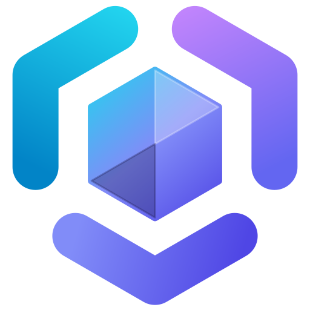

[English](README.md) | [한국어](README.ko.md)

<p align="center"></p>

# Plexus Mod Loader

Plexus Mod Loader는 Minecraft: Java Edition용 모드 로더입니다(버전 2.1.6, 안정 버전). 외부 런처 래퍼 없이 공식 Minecraft 런처에 프로필로 설치되며, 수정되지 않은 바닐라 게임 파일을 로더를 통해 시작하고, Native API로 작성된 자체 Plexus 모드와 함께 Fabric 모드, Quilt 모드, Forge 모드, NeoForge 모드를 로드합니다. Forge와 NeoForge는 그 자체로 실행됩니다. Plexus Mod Loader는 실제 Forge와 FML, 또는 실제 NeoForge와 FML 11을 시작하며, 이러한 모드가 처음 있을 때 해당 파일을 자동으로 다운로드합니다. 게임을 시작하기 전에 모든 모드를 검사하며, 실행할 수 없는 모드는 나중에 충돌을 일으키는 대신 제외하고 `logs/latest.log`에 `PLEXUS-*` 오류 코드를 기록한 뒤 타이틀 화면에 알림을 표시합니다. 설치 프로그램은 [plexusmc.net/download](https://www.plexusmc.net/download/) 또는 [GitHub 릴리스](https://github.com/rigelx2b/Plexus-Mod-Loader/releases)에서 다운로드할 수 있습니다.

## 현황

현재 버전은 **2.1.6** (안정 버전)입니다. 지원 Minecraft 버전은 **1.20.1**, **1.20.4**, **1.21.1**, **1.21.11**, **26.1**, **26.1.1**, **26.1.2**, **26.2**, **26.3** (기본값 **26.3**)입니다. 게임은 **Java 25**를 사용합니다. 26.1 이전 난독화 버전은 매핑 파일이나 jar를 재배포하지 않고 플레이어 PC에서 Mojang 공식 매핑을 온디맨드로 받아 바닐라 게임 jar를 로컬에서 다시 매핑해 실행합니다.

| 모드 유형 / 조합 | 상태 | 세부 사항 및 제한 |
| :--- | :--- | :--- |
| Plexus 모드 | 검증됨 | Native API로 작성된 모드입니다. |
| Fabric 모드 | 검증됨 | 진입점, Fabric Loader API, 중첩 JAR, Mixin, MixinExtras, 클래스 트위커를 지원합니다. Fabric Loader 내부 클래스는 실제 모드가 사용하는 항목만 제공됩니다. |
| Quilt 모드 | 검증됨 | `quilt.mod.json`, Quilt Loader API, Mixin, 액세스 와이드너를 지원하며 2.1.2부터 1.20.1~1.21.11 서버에서도 Quilt 모드가 실행됩니다. 2.1.3부터 1.20.1, 1.20.4, 1.21.1에서 QSL/Quilted Fabric API가 실행되며, 설치된 Quilt 모드에 QSL 모듈이 필요하면 첫 실행 시 Quilted Fabric API 고정 빌드를 자동으로 다운로드합니다(`PLEXUS-DISCOVERY-006`/`007`, `-Dplexus.qsl=off`로 끔). QSL 릴리스가 없는 버전에서는 QSL이 필요한 모드가 제외됩니다(`PLEXUS-COMPAT-303`/`308`/`311`). 2.1.6부터는 Quilt 모드가 1.20.1, 1.20.4, 1.21.1, 1.21.11의 클라이언트 게임 창에서도 월드에 도달합니다(로드 / 미로드: 1.20.1 QSL 제외 261 / 790, 1.20.4 QSL 포함 215 / 64, 1.21.1 QSL 포함 146 / 132, 1.21.11 143 / 124). |
| NeoForge 모드 | 검증됨 | NeoForge 자체 FML 11을 실행합니다(26.3에서 `26.3.0.98`, 26.2에서 `26.2.0.93`). 1.20.4, 1.21.1, 1.21.11에서는 NeoForge `20.4.253`, `21.1.265`, `21.11.48`을 실행합니다(2.1.0부터 헤드리스 검증; 클라이언트 창은 2.1.3에서 모두 검증). 1.20.1용 NeoForge는 없습니다(`PLEXUS-COMPAT-216`). |
| Forge 모드 | 검증됨 | Forge 자체를 실행합니다(26.3에서 `66.1.0`, 26.2에서 `65.1.5`). 1.20.1, 1.20.4, 1.21.1, 1.21.11에서는 Forge `47.4.28`, `49.2.13`, `52.1.21`, `61.2.5`를 실행합니다(2.1.0부터 헤드리스 검증; 클라이언트 창은 2.1.3에서 모두 검증). |
| Forge 또는 NeoForge와 함께 사용하는 Fabric 또는 Quilt | 일부 지원 | Mixin이 패치된 게임과 맞지 않는 Fabric 또는 Quilt 모드는 제외되며(`PLEXUS-COMPAT-224`), 해당 모드를 필요로 하는 모드도 함께 제외됩니다. 2.1.2부터 1.20.1·1.20.4 Forge 옆에서도 Fabric API가 동작하며, 2.1.4부터 1.20.1 Forge 옆에서 Quilt 모드가 실행되고(`corpusQuiltForge`, 110개 모드 로드, 2.1.5), 2.1.3부터 NeoForge `21.1.265`(1.21.1) 및 `20.4.253`(1.20.4) 옆에서도 단일 공유 Mixin으로 Fabric·Quilt 모드가 헤드리스 실행됩니다(로드/미로드 — `corpusFabricNeoForge`: 1.21.1 15/40, 1.20.4 57/80; `corpusFabricOnNeoForge`: 69/88, 1.20.4 65/89; `corpusQuiltNeoForge`: 1.21.1 72/194, 1.20.4 77/179. 1.21.1에서 Forgified Fabric API가 있으면 Fabric API 자체 빌드는 제외되며, 2.1.4부터 NeoForge 21.1.265, 2.1.5부터 NeoForge 20.4.253 옆의 Fabric 모드는 클라이언트 창 검증(`corpusFabricNeoForgeClient`, 월드 진입 후 200틱 실행·종료)을 통과했습니다). |

- **혼용:** Fabric 모드와 Quilt 모드는 서로 함께, 그리고 Plexus 모드와도 함께 실행됩니다. Forge 모드와 NeoForge 모드는 각각 고유한 방식으로 게임 클래스를 패치하므로 한 게임에서 함께 사용할 수 없습니다(`PLEXUS-COMPAT-221`).
- **`검증됨`의 의미:** 단순 로드가 아니라 실제 실행을 거쳤음을 뜻합니다. Modrinth의 실제 인기 모드로 클라이언트에서 저장된 월드에 진입해 틱을 진행하고 저장 후 종료하며, 전용 서버를 시작합니다. 호환성 표기는 이러한 실행 결과를 근거로 합니다: [호환성 레퍼런스](https://www.plexusmc.net/docs/reference/compatibility/).
- **26.1 이전 버전(1.20.1, 1.20.4, 1.21.1, 1.21.11):** Plexus 모드는 실행됩니다. Fabric·Quilt 모드의 intermediary 이름은 플레이어 PC에서 Mojang 이름으로 한 번 번역하므로(2.1.0), 인기 모드 대부분이 로드됩니다. 맞지 않는 모드는 이유와 함께 빠집니다. Forge·NeoForge 모드도 각자의 로더로 실행됩니다(2.1.0, 위 표 참고). 헤드리스 실행(게임 테스트 서버, 전용 서버, 실제 Modrinth 모드 묶음)은 이 버전들에서 모두 검증되었습니다. Forge·NeoForge 게임 창 실행(`corpusForgeClient`, `corpusNeoForgeClient`, 월드 진입 후 200틱 실행·종료)도 2.1.3에서 Forge(1.20.1·1.20.4·1.21.1·1.21.11)와 NeoForge(1.20.4·1.21.1·1.21.11) 모두 통과했습니다(설치된 Forge·NeoForge 런처 프로필도 2.1.4에서 Forge 1.20.1·1.20.4·1.21.1·1.21.11, NeoForge 1.20.4·1.21.1·1.21.11 모두 검증되었습니다).

## 설치

설치 프로그램 JAR 하나로 Windows, macOS, Linux를 지원합니다. 설치 프로그램을 실행하려면 **Java 17 이상**이 필요합니다.

1. [plexusmc.net/download](https://www.plexusmc.net/download/) 또는 [GitHub 릴리스](https://github.com/rigelx2b/Plexus-Mod-Loader/releases)에서 `PlexusModLoader-<version>.jar`를 다운로드합니다.
2. 런처에서 원하는 버전의 바닐라 Minecraft를 한 번 실행한 뒤 런처를 닫습니다.
3. JAR 파일을 더블클릭하거나 `java -jar PlexusModLoader-<version>.jar`를 실행합니다. Minecraft 버전과 런처 폴더를 선택한 뒤 **Install**을 클릭합니다.
4. 런처에서 `Plexus Mod Loader <Minecraft version>` 프로필을 선택하고 플레이합니다. 모드는 런처 폴더의 `mods/` 디렉터리에 넣습니다.

**전용 서버:** `java -jar PlexusModLoader-<version>.jar install-server`를 실행한 다음, 서버 폴더에서 `java -jar plexusmodloader-server.jar`를 실행합니다. Minecraft EULA에는 직접 동의해야 합니다.

전체 가이드: [설치 가이드](https://www.plexusmc.net/docs/getting-started/install/).

## 모드 제작

Plexus 모드는 **Java 25**와 **Gradle**을 사용합니다(**JDK 25** 필요). Gradle은 Mojang에서 Minecraft를 다운로드하고 해시를 확인합니다. Gradle Wrapper가 포함된 이 저장소의 [`templates/plexus-mod-template`](templates/plexus-mod-template)에서 시작할 수 있습니다(`MIT-0` 라이선스, [`templates/LICENSE`](templates/LICENSE) 참고).

공개 API는 Minecraft 클래스를 노출하지 않습니다. Native API는 다음 범위를 다룹니다.

- 블록, 아이템, 몹, 효과 및 블록 엔티티, 메뉴
- 월드 생성 및 차원
- 명령어와 권한, 네트워킹과 접속 검사, 저장 데이터와 동기화
- HUD, 화면, 셰이더 그리기
- 게임 내 테스트, 게임 시스템 교체, 선언적 바이트코드 변환

문서: [첫 번째 모드 튜토리얼](https://www.plexusmc.net/docs/getting-started/first-mod/) | [Native API 가이드](https://www.plexusmc.net/docs/native-api/) | [API 레퍼런스](https://www.plexusmc.net/docs/api-reference/)

## 소스에서 빌드

**JDK 25**와 **Git**이 필요합니다. 빌드는 **Gradle Wrapper 9.8.1** (Kotlin DSL)을 사용합니다. 첫 빌드 시 Mojang에서 Minecraft를 다운로드하고 SHA-1을 검증하며, 게임 JAR 파일은 Gradle 캐시에 유지되고 커밋되지 않습니다.

```sh
git clone https://github.com/rigelx2b/Plexus-Mod-Loader.git
cd Plexus-Mod-Loader
```

| 명령어 (Windows 기준, macOS 및 Linux에서는 `./gradlew` 사용) | 용도 |
| :--- | :--- |
| `.\gradlew.bat check` | 컴파일, 포맷 검사, 단위 및 통합 테스트 |
| `.\gradlew.bat :plexus-installer:installerDistributions` | `plexus-installer/build/distributions/PlexusModLoader-<version>.jar` 빌드 |
| `.\gradlew.bat :plexus-bootstrap:runClient` | 개발용 클라이언트 실행 |
| `.\gradlew.bat :plexus-bootstrap:serverBootSmokeTest` | 실제 서버를 헤드리스로 부팅 (네트워크 필요) |

공개 저장소는 로더의 소스와 빌드를 담고 있습니다. 웹사이트, 설계 문서, 예제 모드, 테스트 모드, 실제 모드 코퍼스 목록은 저장소에서 제외되어 있으며, 이 항목들이 없어도 빌드는 작동합니다.

## 저장소 구조

| 경로 / 패턴 | 역할 |
| :--- | :--- |
| `plexus-bootstrap` | 진입점, 실행 및 검증 Gradle 태스크 |
| `plexus-runtime-api`, `plexus-runtime-impl` | 모드 탐색, 의존성 해결, 런타임 생명주기 |
| `plexus-mod-metadata` | `plexus.mod.json` 파싱 |
| `plexus-transform-api`, `plexus-transform-engine` | 선언적 바이트코드 변환 |
| `plexus-bridge-api`, `plexus-bridge-fabric`, `plexus-bridge-forge` | Fabric/Quilt 및 Forge/NeoForge 모드를 실행하는 브리지 |
| `plexus-fabric-api-forge-v*`, `plexus-fabric-api-neoforge-v*` | Forge 및 NeoForge와 함께 실행되도록 조정된 Fabric API 모듈 |
| `plexus-game-api`, `plexus-event-api`, `plexus-lifecycle-api`, `plexus-system-api`, `plexus-system-registry` | Native API 및 교체 가능한 시스템 |
| `plexus-version-adapter-api`, `plexus-version-adapter-v<id>`, `plexus-game-v<id>` | Minecraft 버전별 어댑터 및 게임 계층 (Minecraft 클래스 이름을 사용하는 유일한 코드) |
| `plexus-early-window` | 초기 로딩 창 |
| `plexus-installer` | 플레이어용 설치 프로그램 |
| `build-logic` | Gradle 컨벤션 플러그인 및 태스크 |
| `templates/plexus-mod-template` | 모드 프로젝트 템플릿 |

모든 모듈에는 영어와 한국어로 작성된 개별 README가 있습니다.

## 문서

- 웹사이트 및 문서: [plexusmc.net/docs](https://www.plexusmc.net/docs/)
- 문제 해결: [문제 해결 가이드](https://www.plexusmc.net/docs/getting-started/troubleshooting/)
- 저장소 문서: [프로젝트 현황 (`PROJECT.md`)](PROJECT.md), [아키텍처 (`ARCHITECTURE.md`)](ARCHITECTURE.md), [개발자 가이드 (`DEVELOPING.md`)](DEVELOPING.md), [변경 내역 (`CHANGELOG.md`)](CHANGELOG.md)
- 측정된 성능: [성능 레퍼런스](https://www.plexusmc.net/docs/reference/performance/). 해당 문서에 측정 방법과 함께 성능 수치가 공개되어 있으며, 이 프로젝트는 측정 결과에 근거해서만 성능을 기술합니다.

## 라이선스

**MIT License**가 적용됩니다([`LICENSE`](LICENSE) 참고). Copyright 2026 _xyrz 및 Plexus Mod Loader 기여자.

- 모든 사본 또는 상당 부분에 저작권 및 라이선스 고지를 유지하는 한, 상업적 이용과 비공개 소스 배포를 포함한 모든 목적으로 Plexus Mod Loader를 사용, 복제, 수정, 병합, 게시, 배포, 재라이선스 및 판매할 수 있습니다. 1.1.0 이후부터 2.0.0까지의 릴리스는 MPL-2.0이 그대로 유지됩니다.
- Plexus Mod Loader를 사용하는 모드, 모드팩, 런처는 각자 자체 라이선스를 선택할 수 있습니다. `templates/`에는 MIT No Attribution 라이선스가 적용됩니다([`templates/LICENSE`](templates/LICENSE) 참고).
- 이 라이선스는 "Plexus"와 "Plexus Mod Loader"라는 명칭 및 로고에는 적용되지 않으며, 수정본에는 별도의 이름을 사용해야 합니다([`TRADEMARKS.md`](TRADEMARKS.md) 참고).
- 서드파티 구성 요소: [`THIRD_PARTY_NOTICES.md`](THIRD_PARTY_NOTICES.md).

공식 Minecraft 제품이 아닙니다. Mojang 또는 Microsoft의 승인을 받지 않았으며 이와 관련이 없습니다.